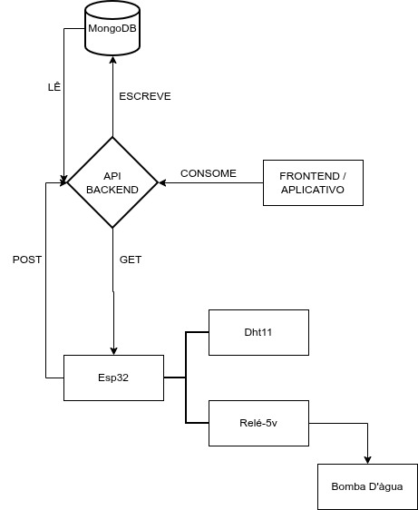

# SmartberryIoT
Projeto da disciplina de Internet das Coisas do 4º semestre do curso de DSM - FATEC Indaiatuba

## Sobre o Projeto

O agronegócio brasileiro possui grande importância para a economia nacional, porém pequenos produtores enfrentam desafios relacionados às mudanças climáticas, escassez de recursos, desperdícios e necessidade de acompanhamento constante da produção.
Pensando nesse cenário, este projeto propõe o desenvolvimento de uma solução inteligente para gerenciamento de estufas, integrando um aplicativo mobile a um sistema de Internet das Coisas (IoT).
A proposta é utilizar sensores para coletar informações do ambiente da estufa, permitindo que o produtor acompanhe dados como temperatura e umidade de forma prática e organizada, sem depender exclusivamente da presença física no local.

## Objetivo
Desenvolver uma solução integrada de aplicativo + IoT para auxiliar pequenos produtores no monitoramento e controle de estufas. O sistema busca:

[] Monitorar Temperatura
[] Acompanhar os níveis de umidade;
[] Auxiliar no controle da irrigação;
[] Coletar e disponibilizar dados do ambiente;
[] Identificar condições fora dos parâmetros definidos;
[] Permitir o acompanhamento por meio do aplicativo;
[] Reduzir a necessidade de monitoramento presencial constante;
[] Diminuir desperdícios de água e outros recursos;
[] Auxiliar na tomada de decisões com base em dados.

## Diagrama de comunicação

O diagrama apresenta o fluxo de comunicação entre os componentes responsáveis pelo monitoramento e controle da estufa. O **ESP32** realiza a comunicação com o sensor **DHT11**, responsável pela coleta de dados de temperatura e umidade, e com o **relé de 5V**, utilizado para o acionamento da **bomba d’água**.

Os dados coletados pelo **ESP32** são enviados por meio de requisições **POST** para a **API Backend**, que realiza o armazenamento das informações no **MongoDB**. O aplicativo/frontend consulta esses dados através de requisições **GET**, permitindo que o produtor acompanhe as condições da estufa.

Dessa forma, a arquitetura integra sensoriamento, armazenamento, comunicação e controle, permitindo o monitoramento remoto da estufa e o acionamento do sistema de irrigação.

### Fluxo principal:

## Desenvolvedores

| Nome | GitHub |
|---|---|
| Cauã Oliveira| @CauaOSantos|
| Julia Rocha | @JuliaPrin3298 |
| Marina Paiva | @marinaluizaaraujo |
| Matheus Vieira | @matvieira7 |
| Murillo Souza | @murillomsouza |
| Raul Corrêa | @raul612 |
